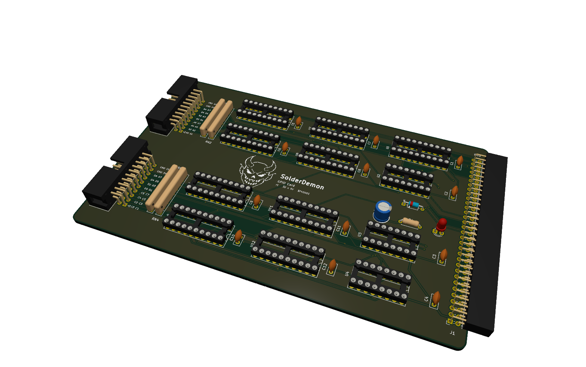
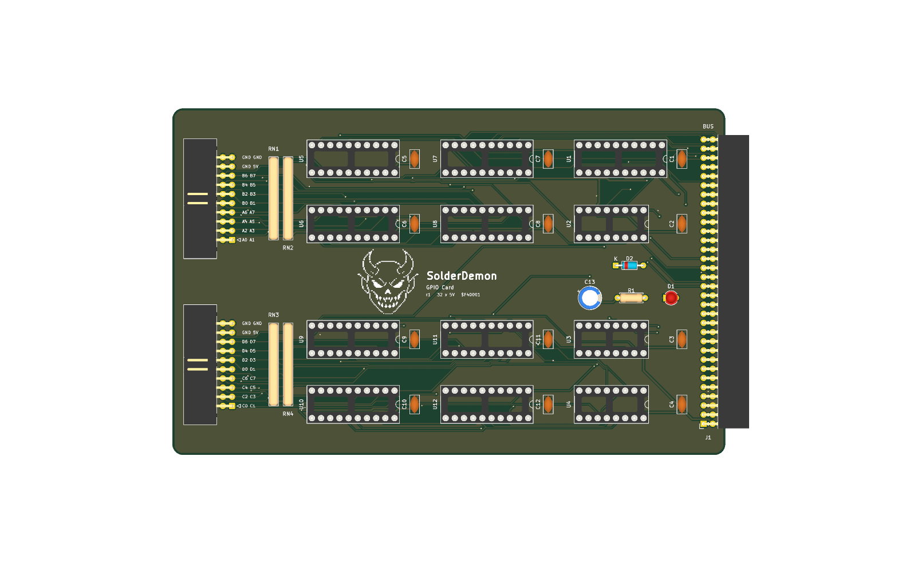

# SolderDemon m68k GPIO — 32 × 5 V, plain 74HCT

Expansion card for the SolderDemon m68k, compatible with rosco_m68k. It connects through J1 and provides **32 GPIO pins** at 5 V logic levels in four 8-bit ports on two IDC headers, J2 and J3. It uses twelve stock 74HCT chips in DIP packages: no port expanders, no programmable parts, no 3.3 V rail.

J1 has the same pinout and signals as the rosco_m68k r2 expansion bus, so the card works in both systems.



**Status:** revision r1, the first SolderDemon revision. The schematic and the routed two-layer PCB are generated by scripts. No board has been manufactured yet; see [Verification](#verification).

## At a glance

| | |
|---|---|
| Registers | `$F40001` A, `$F40003` B, `$F40005` direction, `$F40007` C, `$F40009` D; byte access only |
| Logic | 74HCT688 + 74HCT238 + 74HCT138 decode, BAT85 diode for DTACK |
| Ports | per port: 74HCT574 latch with tri-state outputs → pins → 74HCT541 read-back; 74HCT175 direction |
| Direction | per 8-pin port |
| Pull-ups | 10 kΩ on every pin (4 × SIP-9 arrays) |
| Power | 5 V from the bus |
| Assembly | through-hole only, every IC socketed, nothing to program |
| Size | 153 × 96 mm, 2 layers |



## J2 / J3 connectors

Right-angle shrouded IDC 2×10 headers, 2.54 mm pitch, J2 above J3. Pin 1 is marked with a triangle.

| Pins | J2 | J3 |
|---|---|---|
| 1–8 | A0–A7 (driver bits 0–7) | C0–C7 (bits 16–23) |
| 9–16 | B0–B7 (bits 8–15) | D0–D7 (bits 24–31) |
| 17, 19, 20 | GND | GND |
| 18 | +5V from the bus, no fuse | +5V from the bus, no fuse |

Keep the total load on pin 18 around 100 mA or less. Outputs swing to 5 V. HCT inputs accept 3.3 V logic, but a 3.3 V device must not be connected to a port configured as an output.

## Registers

| Address | Write | Read |
|---|---|---|
| `$F40001` | port A output latch | port A pin levels |
| `$F40003` | port B output latch | port B pin levels |
| `$F40005` | direction: b0 A, b1 B, b2 C, b3 D; 1 = output | — |
| `$F40007` | port C output latch | port C pin levels |
| `$F40009` | port D output latch | port D pin levels |

System reset clears the direction register, so every pin starts as an input. Every byte (odd-address) cycle in `$F40000–$F41FFF` gets DTACK; unused addresses read as garbage, and even-address access ends in a bus error.

## Example

```c
#include "gpio.h"

gpio_init();                                        /* all inputs, latches 0 */
gpio_config(GPIO_DIR_A | GPIO_DIR_C, 0x00000000);   /* A and C outputs (low), B and D inputs */
gpio_write_pin(16, true);                           /* J3.1 (C0) = 5 V */
uint32_t in = gpio_read();                          /* B in bits 8..15, D in bits 24..31 */
```

`gpio_selftest()` drives every pin with test patterns and returns a mask of failed pins; run it with J2 and J3 disconnected.

`gpio_write_port(port, value)` and `gpio_read_port(port)` touch one 8-bit port (0..3 = A..D) with a single register access and leave the other ports alone.

For a PS/2 keyboard and mouse on J2 or J3, see the [GPIO PS/2 adapter](../solderdemon_m68k-gpio-ps2).

## Files

| Path | Contents |
|---|---|
| `solderdemon_m68k-gpio.kicad_pro` / `.kicad_sch` / `.kicad_pcb` | KiCad 10 project |
| `solderdemon_m68k-gpio.kicad_sym`, `solderdemon_m68k-gpio.pretty/` | local bus symbol, the J1 socket footprint and the SolderDemon logo |
| `logo.png` | logo source; `tools/make_logo.py` turns it into `SolderDemon_Logo` (same generator and size as on the busboard) |
| `manufacturing/` | Gerbers, drill file, BOM, placement file, schematic PDF |
| `software/` | driver `gpio.c/.h`, example `main.c`, Makefile |
| `tests/test_driver.c` | driver test against a model of the latches, direction register and pull-ups |
| `tools/build_card.py`, `tools/make_bus_footprint.py`, `tools/make_logo.py`, `tools/route_card.py`, `tools/cleanup_dangling.py` | schematic/PCB generation, J1 footprint, routing, router clean-up |
| [docs/DESIGN.md](docs/DESIGN.md) | how the card works: addressing, bus cycles, DTACK diode, levels, power |
| [docs/BRINGUP.md](docs/BRINGUP.md) | assembly and first power-up |
| [docs/BUILD.md](docs/BUILD.md) | regenerating the files |

Unreleased prototypes that preceded r1 are archived in `solderdemon_m68k-gpio-backups/`: an MC68B21 PIA design in `r1-pia-spi/`, 2 × MCP23S17 with 5 V + 3.3 V banks in `r2-mcp23s17/`, and a 16-pin 74HCT version (ports A/B only, 8 ICs) in `r3-16pin/`.

Copyright © 2026 SolderDemon. The GPIO hardware and driver were authored by Mykhailo. The J1 expansion bus follows the [rosco_m68k](https://github.com/rosco-m68k/rosco_m68k) interface (Ross Bamford, The Really Old-School Company Limited, and contributors) for compatibility; its copyright and licence terms remain in force.

## Verification

- ERC: 0 errors, 0 warnings (`erc.rpt`).
- DRC with schematic parity: 0 violations, 0 unconnected pads, 0 footprint errors (`drc.rpt`).
- Placement: three IC columns on one four-row grid, symmetric about the board centre line; logo, DTACK diode and power parts in the centre band. J2/J3 body centres at y = 25/71 mm, centred as a pair on the 96 mm board; RN1/RN2 and RN3/RN4 follow their respective headers.
- Routing: 1701 tracks and vias (77 vias), GND pour on both layers.
- /DTACK: checked against the SolderDemon m68k address decoder (GAL and CPLD r2.14) — the output is open drain (`DTACK.E` / `DTACK.oe` only) with R21 1.2 kΩ pull-up, so the D2 diode wired-OR is valid. Worst-case low level ≈0.66 V vs VIL 0.8 V.
- Driver: the real `gpio.c` against a model of four latches, the direction register and pull-ups, including self-test fault detection, output-glitch checks and single-port access — PASS (`driver-verification.txt`).
- **Not yet verified:** a physical board, timing and the /DTACK low level on a scope, a build with the m68k cross-compiler.
