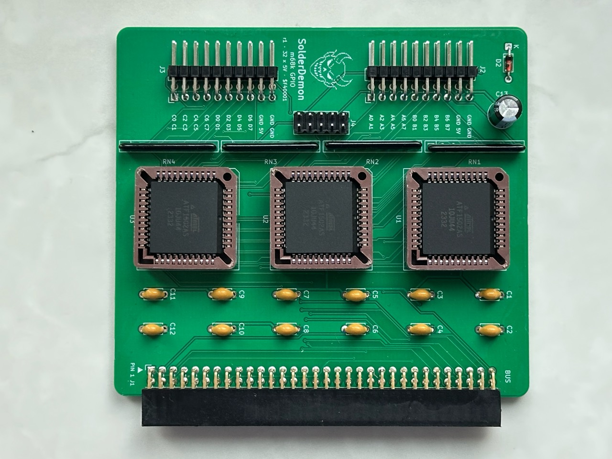

# SolderDemon m68k GPIO

Adds 32 GPIO lines at 5 V logic levels in four 8-bit ports. Two right-angle headers expose the signals, and three ATF1502AS CPLDs handle bus decoding and port control.

J1 matches the expansion bus pinout of [rosco_m68k r2](https://github.com/rosco-m68k/rosco_m68k). The original rosco_m68k project was created by Ross Bamford, The Really Old-School Company Limited, and contributors.

**Status.** r1 fabrication files and CPLD programming files are available. An assembled board is shown below. Hardware verification is pending.



[Top view](solderdemon_m68k-gpio-top.png) · [Bottom view](solderdemon_m68k-gpio-bottom.png)

## Start here

- [KiCad project](design/solderdemon_m68k-gpio.kicad_pro)
- [Schematic (PDF)](manufacturing/solderdemon_m68k-gpio-schematic.pdf)
- [Gerbers and drill files](manufacturing/solderdemon_m68k-gpio-fab.zip)
- [Assembly and bring-up](docs/BRINGUP.md)

## Features

| | |
|---|---|
| Registers | `$F40001` A, `$F40003` B, `$F40005` direction, `$F40007` C, `$F40009` D; byte access only |
| Logic | 3 × ATF1502AS-10JU44 in PLCC-44 sockets, programmed in one J4 JTAG chain; BAT85 diode for DTACK |
| Ports | registered CPLD outputs, tristated by the direction register; readback senses the header pins |
| Direction | per 8-pin port |
| Pull-ups | 10 kΩ on every pin (4 × SIP-9 arrays) |
| Power | 5 V from the bus |
| Assembly | through-hole only, 3 × PLCC-44 sockets, CPLDs need JEDEC files and a JTAG programmer |
| Size | 86 × 96 mm, 2 layers |


## J2 / J3 connectors

Two right-angle, unshrouded 2×10 pin headers, 2.54 mm pitch, in the original connector positions on the left edge. J2 is above J3. Pin 1 is marked on the PCB.

| Pins | J2 | J3 |
|---|---|---|
| 1–8 | A0–A7 (driver bits 0–7) | C0–C7 (bits 16–23) |
| 9–16 | B0–B7 (bits 8–15) | D0–D7 (bits 24–31) |
| 17, 19, 20 | GND | GND |
| 18 | +5V from the bus, no fuse | +5V from the bus, no fuse |

All VCC pins of U1–U3 connect to the bus +5 V rail. The CPLD output drive differs from the previous 74HCT574; size external loads to the ATF1502AS datasheet. The unshrouded headers have no key; check cable orientation before connecting an adapter.

## Registers

| Address | Write | Read |
|---|---|---|
| `$F40001` | port A output latch | port A pin levels |
| `$F40003` | port B output latch | port B pin levels |
| `$F40005` | direction: b0 A, b1 B, b2 C, b3 D; 1 = output | — |
| `$F40007` | port C output latch | port C pin levels |
| `$F40009` | port D output latch | port D pin levels |

System reset clears the direction register, so every pin starts as an input. Every byte (odd-address) cycle in `$F40000–$F41FFF` gets DTACK; unused addresses read as garbage, and even-address access ends in a bus error.

## Example

```c
#include "gpio.h"

gpio_init();                                        /* all inputs, latches 0 */
gpio_config(GPIO_DIR_A | GPIO_DIR_C, 0x00000000);   /* A and C outputs (low), B and D inputs */
gpio_write_pin(16, true);                           /* J3.1 (C0) = 5 V */
uint32_t in = gpio_read();                          /* B in bits 8..15, D in bits 24..31 */
```

`gpio_selftest()` drives every pin with test patterns and returns a mask of failed pins; run it with J2 and J3 disconnected.

`gpio_write_port(port, value)` and `gpio_read_port(port)` touch one 8-bit port (0..3 = A..D) with a single register access and leave the other ports alone.

For a PS/2 keyboard and mouse on J2 or J3, see the [GPIO PS/2 adapter](../solderdemon_m68k-gpio-ps2).

## Design files

| Path | Contents |
|---|---|
| `design/solderdemon_m68k-gpio.kicad_pro` / `.kicad_sch` / `.kicad_pcb` | KiCad 10 project |
| `solderdemon_m68k-gpio.kicad_sym`, `solderdemon_m68k-gpio.pretty/` | local CPLD/bus symbols, the J1 socket footprint and the SolderDemon logo |
| `code/firmware/cpld/gpio_decode.pld`, `gpio_ab.pld`, `gpio_cd.pld`, `build.sh` | ATF1502AS logic, pinouts and JEDEC builds |
| `logo.png` | logo source; `tools/make_logo.py` turns it into `SolderDemon_Logo` (same generator and size as on the busboard) |
| `manufacturing/` | r1 Gerbers, drill, fab zip, pos, BOM and schematic PDF |
| `code/software/` | driver `gpio.c/.h`, example `main.c`, Makefile |
| `code/tests/test_driver.c` | driver test against a model of the latches, direction register and pull-ups |
| `tools/build_card.py`, `tools/make_bus_footprint.py`, `tools/make_logo.py`, `tools/route_card.py`, `tools/cleanup_dangling.py` | schematic/PCB generation, J1 footprint, routing, router clean-up |
| `tools/cupl.py`, `tools/sim_card.py` | CUPL source interpreter and GPIO behavior checks |
| [docs/DESIGN.md](docs/DESIGN.md) | how the card works: addressing, bus cycles, DTACK diode, levels, power |
| [docs/TIMING.md](docs/TIMING.md) | worst-case bus timing against the MC68010 at 10 MHz, /DTACK level |
| [docs/BRINGUP.md](docs/BRINGUP.md) | assembly and first power-up |
| [docs/BUILD.md](docs/BUILD.md) | regenerating the files |


## Verification

- r1 schematic ERC: 0 violations; schematic/PCB parity: 0 issues.
- All three CPLD sources fit successfully with locked pins and JEDEC output (decoder 11/32 macrocells, each port CPLD 27/32). CUPL source simulation passes address decode, writes, reset and pin readback. ERC: 0 violations. Routed DRC: 0 violations, 0 unconnected pads, 0 schematic parity issues; 123 vias. Worst-case timing at 10 MHz: reads with zero wait states (/DTACK margin 75 ns, data margin 167 ns), writes with at most one; see docs/TIMING.md. The driver test models the register interface, but it does not verify the new CPLD fuse maps.
- Physical board and /DTACK level on an oscilloscope remain unverified.

<!-- repository-layout -->
## Repository layout

- [`design/`](design/solderdemon_m68k-gpio.kicad_pro): KiCad project, schematic sheets, PCB, local libraries and design data. Open the project directly here.
- [`code/firmware/`](code/firmware/): ROM and programmable-logic sources and programming files.
- [`code/software/`](code/software/): drivers, examples and applications.
- [`code/build/`](code/build/): local build products; ignored by Git except for its README.
- [`tools/`](tools/): generators, simulations and export scripts. Run commands from the repository root unless stated otherwise.
- [`manufacturing/`](manufacturing/): fabrication packages.

Programmable-logic files are in `code/firmware/cpld/`. Native CPLD tools retain their adjacent `bin/` outputs.
Design files and documentation are generated by scripts in `tools/`; change the sources and regenerate. Keep `.kicad_pro` as the source of DRC rules.
<!-- /repository-layout -->

## Licences and attribution

No repository-wide licence is currently specified. Consult the notices retained in individual source files and third-party material.

Copyright © 2026 SolderDemon. The GPIO hardware and driver were authored by Mykhailo. Retained source and third-party notices are preserved.
